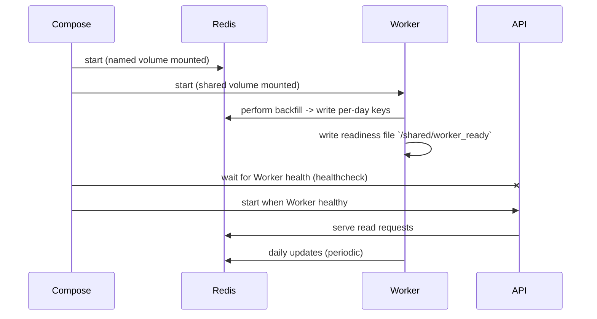
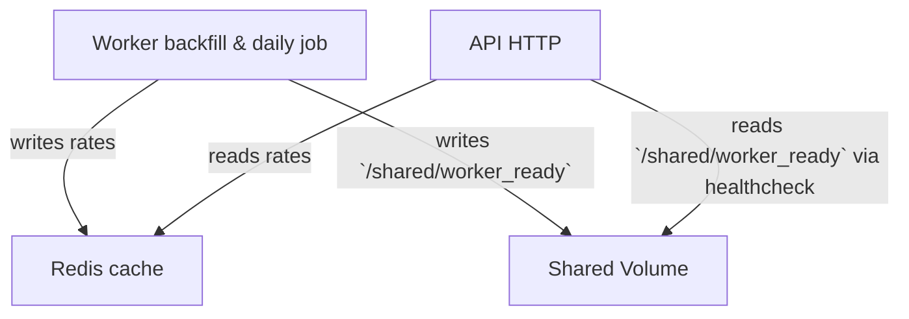

# ExchangeRateUpdater — Architecture & Docker Compose Overview

This repository contains an ExchangeRateUpdater system composed of three main services coordinated with Docker Compose:

- Redis — distributed cache and optional pub/sub transport
- Worker — background service that performs backfills and daily updates and signals readiness
- API — HTTP service that serves exchange rate queries and depends on the worker being healthy

This document explains the architecture, startup sequence, readiness signalling, healthchecks, shared volumes, and operational best practices. It also includes diagrams (Mermaid) and simple commands for running the system locally with Docker Compose.

## Goals and Problem Statement

The system is designed to reliably populate and serve exchange rate data for two languages (CZ and EN). Key requirements:

- Populate historical rates (bulk backfill) when data is missing.
- Continuously refresh daily rates.
- Provide cached, fast read access via the API.
- Coordinate startup so the API does not accept traffic until the Worker has completed its initial backfill.
- Use Redis as the shared cache and, optionally, a message bus for cross-service notifications.

## High-level Architecture

- Worker: on startup, runs a bulk backfill job (multi-year) across languages and writes per-date rates into the cache. When the initial backfill completes the worker writes a readiness file into a shared Docker volume (`/shared/worker_ready`). The worker continues running and updates daily rates.
- API: exposes HTTP endpoints to read exchange rates (reads exclusively from Redis). The API includes an HTTP health endpoint and only starts accepting traffic once the Worker is healthy.
- Redis: stores cached exchange rates keyed by language + date and provides data persistence (named Docker volume) across container restarts.

Mermaid sequence diagram (startup + readiness):



Component diagram:



## Startup sequence and readiness signaling

1. Docker Compose creates named volumes and starts containers in dependency order. Redis usually starts first because other services rely on it.
2. The Worker container starts and immediately begins the bulk backfill job. This job fetches historical rates (years back) and writes them into Redis. The Worker implements parallel processing and uses the cache repository to store per-day dictionaries keyed by language and date.
3. After the backfill completes, the Worker writes a small readiness file into the shared volume: `/shared/worker_ready` (content `ready`). This file acts as a file-system-native readiness signal that the initial population is complete.
4. The Worker container exposes a Docker healthcheck that returns success only when the readiness file exists. Docker Compose uses the worker health status when evaluating dependencies.
5. Docker Compose starts the API container only after the Worker is healthy (Compose `depends_on: condition: service_healthy`). The API also has its own HTTP health endpoint (e.g., `/health`) which it uses for liveness probing and monitoring.

Notes:
- The readiness file enables decoupling the worker's internal logic from the container lifecycle. It's durable across simple container restarts when using the shared volume.
- The Worker continues to run after writing the readiness file. It performs daily updates and refreshes the cache for new dates.

## Healthchecks and Compose dependency behavior

- Worker healthcheck: checks for the presence of `/shared/worker_ready`. Example shell-style healthcheck:

	- Command: `CMD test -f /shared/worker_ready || exit 1`

- API healthcheck: performs an HTTP request against the API (`/health`) and expects a 200 OK response.

- Docker Compose `depends_on`: use the `condition: service_healthy` option (Compose v2+ uses `healthcheck` and `depends_on` to control startup ordering). This ensures API container will not be considered started (or will not be routed to) until the Worker reaches the healthy state.

## Purpose of shared volumes

- Data persistence for Redis: a named volume such as `redis-data` stores Redis data files so that restart of the Redis container preserves the dataset.
- Coordination and signaling: a shared volume (e.g., `shared`) mounted at `/shared` in both Worker and API containers is used to exchange the readiness file. The Worker will write `/shared/worker_ready` and the API's healthcheck (or a sidecar script) can read it to determine if the worker completed initial setup.

File-system-based signaling is simple, robust, and works across containers on the same Docker host without additional orchestration dependencies.

## How caching is organized

- Keys: the system uses strongly named cache keys in the form `exrates:{language}:{yyyy-MM-dd}`. Each key maps to a dictionary keyed by source currency code, or a list when used by application endpoints.
- TTL: cached entries are written with an expiration time computed from a configured TTL (e.g., 4 years). This keeps historical entries valid while allowing future expiration.
- Redis storage strategy: the Redis implementation stores per-day dictionaries as either Redis hashes (one entry per source currency) or as serialized JSON for lists depending on the access pattern.

## Design patterns and architectural choices

- Clean Architecture: the codebase separates domain, application, infrastructure, and worker orchestration concerns. This keeps business rules decoupled from technical details.
- CQS (Command-Query Separation) & Mediator: application-level queries and commands use a Mediator pattern to centralize handling. Queries only read data while commands mutate state.
- Background worker (Cron-like behavior): the Worker has two responsibilities: an initial backfill and periodic daily updates. This keeps the API focused on serving reads and reduces request latency.
- File-based readiness signaling: chosen because it's simple and requires no coordinator service. It is sufficient for single-host Docker Compose deployments.

## How to run the system (local / dev)

Prerequisites: Docker and Docker Compose installed.

1. From the `root` folder run:

```bash
docker compose up --build
```

2. Compose will show Redis starting, then the Worker beginning the backfill. The Worker will log progress (processed years/dates). When the Worker finishes the initial backfill it writes `/shared/worker_ready` into the shared volume and becomes healthy.

3. Once the Worker healthcheck passes, Compose will start the API and it will register as healthy after its `/health` endpoint responds.

4. Use the API to query rates (example):

```bash
curl http://localhost:5000/api/exchangerates?date=2025-11-27
```

## Example Docker Compose considerations

- Volumes:
	- `redis-data` — persist Redis RDB/AOF files.
	- `shared` — mounted to both Worker and API at `/shared` so they can exchange the readiness file.

- Healthchecks:
	- Worker: file-existence script checking `/shared/worker_ready`.
	- API: HTTP GET `/health` expecting 200.

- depends_on with health conditions ensures proper start ordering for Compose v2+.

## Best practices for container orchestration & reliability

- Prefer orchestration platforms (Kubernetes, ECS) for production. They offer richer primitives (readiness/liveness probes, rollout strategies, PodDisruptionBudgets, init containers) and cluster-wide scheduling.
- In Kubernetes, replace file-based readiness with:
	- an init container that runs the initial backfill (if you prefer one-time init semantics), or
	- use the same Worker as a separate Deployment and use a readiness probe that checks a status endpoint instead of a file.
- Use robust retries and circuit breakers when calling remote ExchangeRate APIs (Polly or native SDKs). Keep network timeouts small and implement exponential backoff.
- Use monitoring and metrics: expose Prometheus metrics from both API and Worker (rate of processed dates, errors, cache hit/miss rates).
- Use alerting on healthcheck failures, high error rates, or Redis memory pressure.
- Practice blue/green or rolling deployments for API changes. Ensure backward compatibility for cache key format.
- Secure Redis with authentication and network policies in production. Don't expose Redis to public networks.

## Observability and troubleshooting

- Logs: Worker logs contain progress info for backfill and daily updates. API logs should correlate requests with cache keys.
- Health endpoints: both Worker (file readiness) and API (`/health`) provide quick status checks for orchestration and monitoring.
- Redis inspection: use `redis-cli` to inspect keys (`KEYS exrates:*`) and TTLs.

## Diagram explanation

- Sequence diagram: shows how Compose brings up Redis and Worker first, Worker populates Redis and writes the readiness file, and when Worker is healthy Compose brings up the API.
- Component diagram: shows data flow: Worker writes, API reads, Redis stores, and the shared volume carries the readiness file.

## Notes and future improvements

- For distributed deployments, remove file-based readiness and replace it with a network-accessible readiness endpoint or a small coordination service (e.g., lease in Redis, or a k8s `Job` + `Deployment` pattern).
- Consider sharding Redis keys by language or date range if the record set grows very large.
- Add integration tests that start a Compose environment and verify the end-to-end backfill and API responses.

